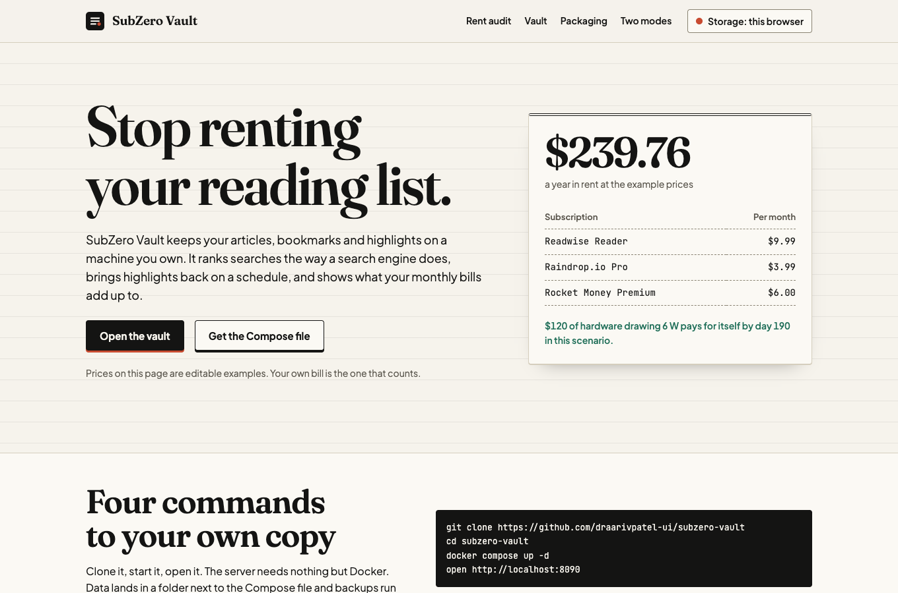
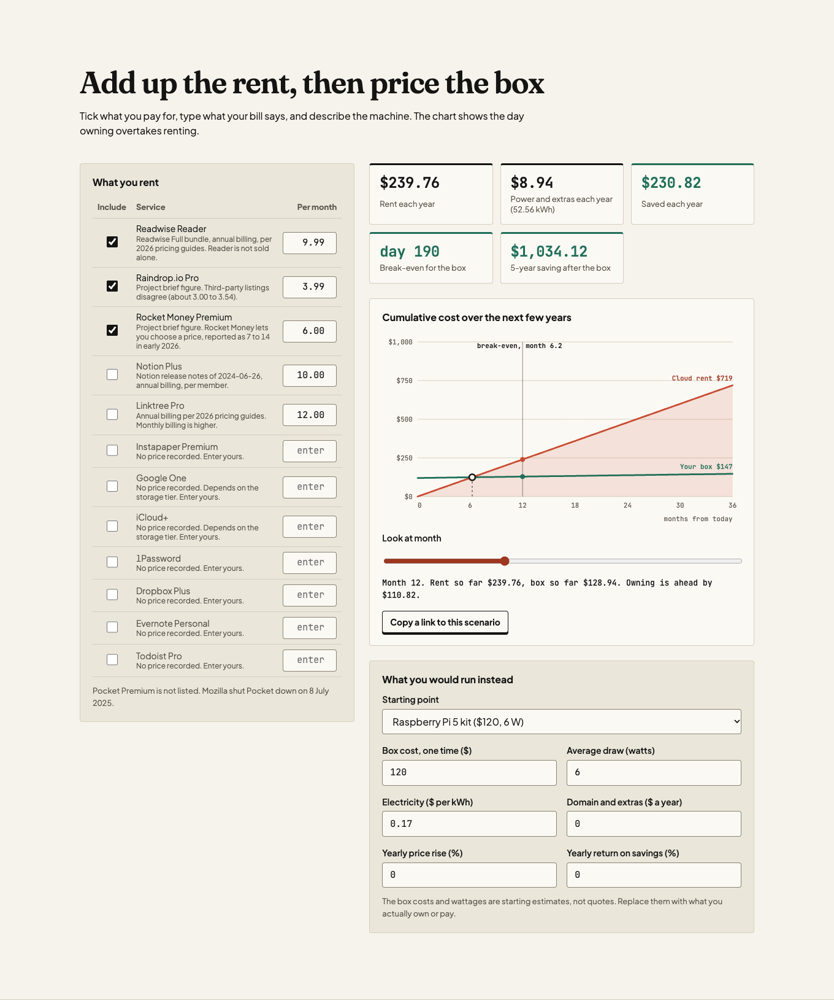
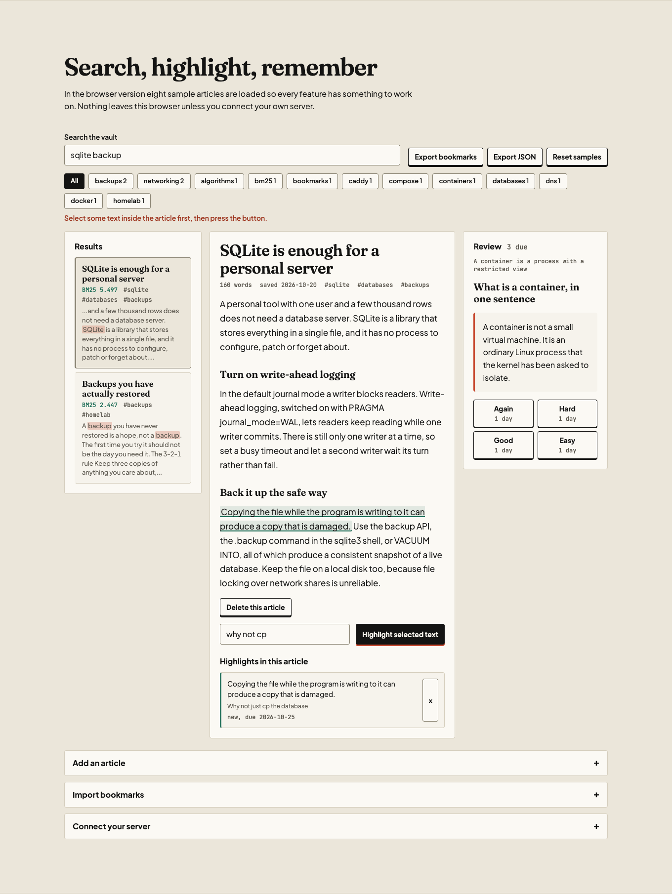
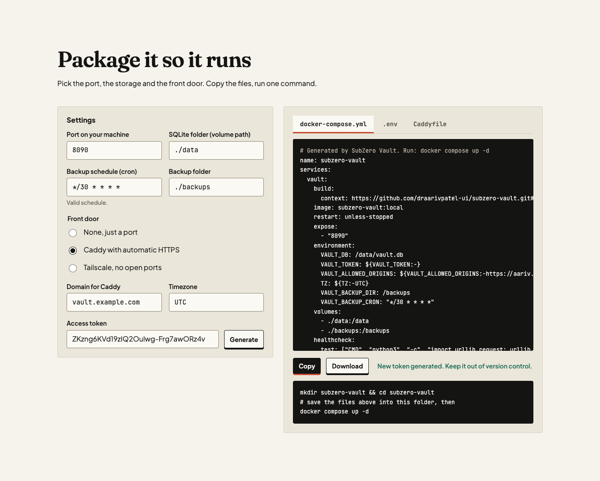
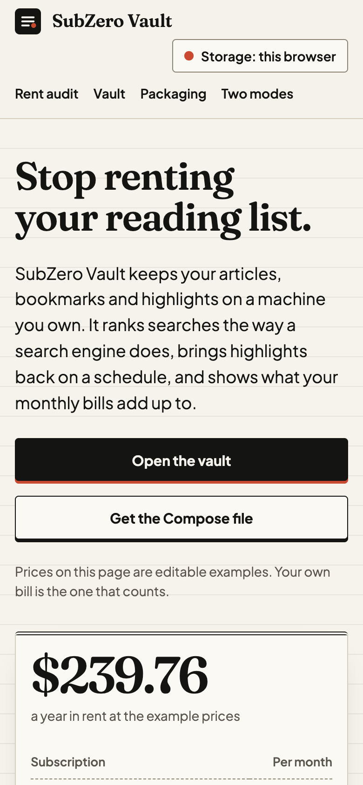

# SubZero Vault

A self-hosted replacement for paid read-it-later, bookmark and highlight apps like Readwise Reader and Raindrop.io Pro, plus a calculator that adds up what those subscriptions (and others, Rocket Money included) cost you each year. Run it with `docker compose up -d`, or try the whole thing in your browser at [aariv.me/subzero-vault](https://aariv.me/subzero-vault/).



**How this was made.** The code, tests and copy in this repository were written by an AI assistant (Claude) at the owner's request, and no Hackatime or Lapse hours were tracked for it. CloudFALL asks for tracked hours and allows at most 30 percent AI-assisted work, so as built this is not an eligible CloudFALL submission. See NOTES.md.

## Quickstart

```
git clone https://github.com/draarivpatel-ui/subzero-vault
cd subzero-vault
docker compose up -d
open http://localhost:8090
```

The server needs no configuration. The database lives in `./data`, backups land in `./backups` every night at 03:00, and the container restarts itself after a reboot. To change anything, copy `.env.example` to `.env`.

On a fresh install the vault is empty. The results panel has a button that loads eight sample articles so you can try search, highlights and review straight away.

No Docker? The server is one file that uses only the Python standard library.

```
python3 server/app.py --port 8090
```

## What is in it

**Search.** Okapi BM25 ranking with `k1 = 1.5` and `b = 0.75`. Title words count three times and tag words twice. Results show their score and a snippet with the matching words marked.

**Highlights and review.** Select text in the reader to save a highlight. Highlights come back on the SuperMemo SM-2 schedule, with four answers (again, hard, good, easy). Each button shows how many days away it would push the card.

**Readable text.** Paste a page's HTML and a readability pass keeps the story and drops navigation, sidebars and footers. With a token set, the server also gives you a bookmarklet that saves the page you are looking at.

**Bookmarks in and out.** Imports the HTML file every browser can export (the Netscape bookmark format), keeps folders, tags, dates and notes, skips `javascript:` links and repeats. Exports the same format. JSON export too.

**Rent audit.** Twelve subscriptions, each with a tick and an editable monthly price, set against a box you own, its wattage and your electricity rate. It shows rent per year, power per year, the saving, the day the box pays for itself and a 36 month chart of both lines. The scenario lives in the page address, so a link shares it.

**Packaging studio.** Pick the port, volume folder, backup schedule and front door (nothing, Caddy with automatic HTTPS, or Tailscale). Get a matching `docker-compose.yml`, `.env` and `Caddyfile` to copy or download.

| Screenshot | What it shows |
| --- | --- |
|  | Ticking subscriptions, the break-even chart and the box inputs |
|  | A BM25 search, the reader, a saved highlight and a review card |
|  | Compose output for Caddy with a 30 minute backup schedule |
|  | The same page on a 390 pixel wide phone |

## The numbers on the page

The three headline subscriptions use example prices of `$9.99`, `$3.99` and `$6.00` a month, which add up to `$239.76` a year. These are starting figures, not quotes. NOTES.md records where each came from and where sources disagreed. Rocket Money in particular lets you choose a price. Edit any figure on the page and everything recomputes.

With the default box (a `$120` Raspberry Pi 5 kit drawing 6 W at `$0.17` per kWh, which are estimates) the electricity costs `$8.94` a year, the net saving is `$230.82` a year, and the box pays for itself on day 190.

Rocket Money's bank sync and bill negotiation are not replaced. The audit is a calculator you fill in by hand.

## How it fits together

```
  browser (index.html, app.js, engine.js)          server (server/app.py)
 +-----------------------------------+          +--------------------------+
 | views: ledger, chart, vault,      |  fetch   | HTTP API + static files  |
 | review, packaging studio          +--------->| BM25, SM-2, readability, |
 |                                   | JSON     | bookmarks, savings       |
 | LocalStore  (localStorage)        |  token   |                          |
 | ServerStore (calls the API)       |          | SQLite (WAL) + backups   |
 +-----------------------------------+          +--------------------------+
        engine.js and server/app.py implement the same maths.
        tests/fixtures/parity.json holds numbers both must agree on.
```

The page works in two modes. In browser mode everything is stored in local storage and clearing site data clears the vault. In server mode the same page talks to your server. Open the server's own address and the page connects by itself, or use the connect drawer from another site such as the hosted demo. Browsers differ on whether an https page may call a plain http address on your own machine, and some ask for permission first. If yours blocks it, open the server's own address, which serves the same app.

## API

All routes are under `/api`. With `VAULT_TOKEN` set, send `Authorization: Bearer <token>`.

| Route | Does |
| --- | --- |
| `GET /health` | status, no auth |
| `GET /api/articles?tag=` | list |
| `POST /api/articles` | add `{title, url, tags, html or text}` |
| `GET` and `DELETE /api/articles/<id>` | read, delete |
| `POST /api/articles/<id>/highlights` | add `{text, note}` |
| `GET /api/highlights?article=<id>` | list |
| `GET /api/review/due?today=YYYY-MM-DD` | highlights due |
| `POST /api/review/<id>` | rate `{quality: 0 to 5}` |
| `GET /api/search?q=&tag=&limit=` | BM25 results with snippets |
| `POST /api/import` | `{html}` bookmarks file |
| `GET /api/export?format=netscape` or `json` | download |
| `POST /api/savings` | the calculator, as JSON |
| `POST /api/clip?token=` | bookmarklet endpoint, off unless a token is set |

## Configuration

| Variable | Default | Meaning |
| --- | --- | --- |
| `VAULT_PORT` | `8090` | host port in Compose, listen port in the server |
| `VAULT_TOKEN` | empty | bearer token. Empty means the API only answers requests addressed to `localhost`, `127.0.0.1` or `::1` (other names and LAN addresses get a 403) |
| `VAULT_ALLOWED_ORIGINS` | `https://aariv.me` | websites allowed to call the API from a browser |
| `VAULT_DB` | `./data/vault.db` | SQLite file |
| `VAULT_BACKUP_DIR`, `VAULT_BACKUP_CRON` | `/backups`, `0 3 * * *` in Compose | scheduled backups, 5 field cron, 14 kept |

Take a backup by hand with `docker compose exec vault python3 server/app.py --backup /backups`.

If you expose the server beyond your own machine, set a token and put it behind Caddy or Tailscale. The studio generates both setups.

## Tests

```
npm test                       # 186 engine and page tests, Node 18 or newer, no dependencies
python3 server/app.py --selftest   # 229 checks, then a live server is started and every endpoint is called
```

The Node suite covers the maths (hand computed BM25 and SM-2 values), readability, bookmarks, the Compose generator, page markup rules (labels, live regions, meta tags, colour tokens) and the page controller against a small fake DOM. The Python self test replays `tests/fixtures/parity.json` so the two implementations stay in step.

## Layout

```
index.html styles.css app.js engine.js samples.js   the web app
server/app.py                                       the server
Dockerfile docker-compose.yml .env.example          packaging
tests/                                              node:test suites and fixtures
scripts/                                            fixture and social image sources
fonts/                                              Fraunces, Plus Jakarta Sans, JetBrains Mono (SIL OFL)
```

## Licence

MIT. See `LICENSE`. Fonts are under the SIL Open Font License, noted in `fonts/LICENSE-FONTS.txt`.
